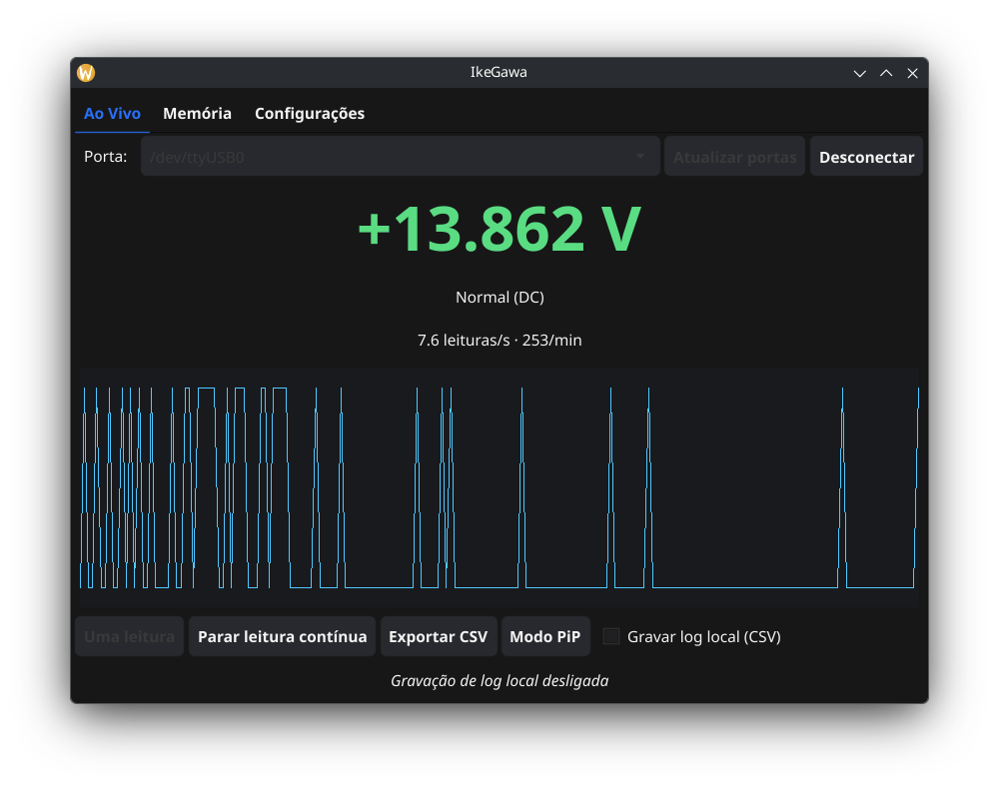

# IkeGawa

*[Leia isto em português](README.md)*

A live-reading and memory-download GUI for Yokogawa TY710/TY720/TY530
digital multimeters via the 92015 communication adapter (protocol
documented in the Yokogawa manual `IM92015-02E`).

Written in Go + [Fyne](https://fyne.io). Runs on Linux, Windows and macOS.
The interface itself has a language switcher (Português/English) built in.



## Features

- **Live**: pick the serial port, connect, and it starts reading right away
  (nothing else to click), shows the current reading front and center with
  a color per status (normal/over-range/low battery), a readings/s and
  /min counter, a live chart of the last 200 points, and CSV export of the
  session's history. If the instrument stops responding (e.g. it was
  powered off), the app notices within a few seconds, says so on screen,
  and resumes reading on its own once it's back — no freeze, no need to
  reconnect the port.
- **Optional local log**: a "Record local log (CSV)" checkbox — when
  turned on, every live reading is appended to its own file
  (`ikegawa_YYYY-MM-DD_HH-MM-SS.csv`, one per recording session) under the
  configured log folder (by default `~/.config/IkeGawa/logs/` or the OS
  equivalent). Off by default; this is independent of the instrument's own
  internal memory.
- **PiP mode**: a compact window (320×140, no chart, no tabs, no controls)
  showing just the current value — meant to be captured as an overlay in a
  livestream (it's a separate window, so you can crop it as a source in
  OBS/etc).
- **Memory → Save mode**: read one specific slot (0-99) or download all 100
  at once, with a progress bar and CSV export.
- **Memory → Logging mode**: query the record count and sampling interval,
  download all records with a progress bar/cancel button, and export to
  CSV.
- **Settings**: switch the interface language and pick where the local log
  is saved (or reset it to the default) — both choices persist across
  restarts.

## Project layout

```
.
├── main.go, chart.go, csv.go, log.go, memory.go, i18n.go   # the Fyne app (package main)
├── internal/typroto/                                        # 92015 protocol implementation
├── build/                                                    # Dockerfiles + compiled binaries (git-ignored)
├── build.sh, build-linux.sh, build-windows.sh                # Docker-based builds, no local Go/gcc needed
└── dev-tools/
    └── ty_read.py                                            # standalone script used to prototype/debug the protocol
```

`dev-tools/ty_read.py` isn't used by the app itself — it's just a small
Python (pyserial) helper for poking at the instrument's raw protocol
straight from the terminal, without compiling anything.

## Running

```
./build/ikegawa-linux-amd64        # Linux
build\ikegawa-windows-amd64.exe    # Windows
```

## Setting up the FTDI adapter on Linux

The 92015 cable/adapter uses an FTDI chip and shows up as a regular serial
port (`/dev/ttyUSB0`, `/dev/ttyUSB1`, etc). It's usually plug-and-play, but
a few things help when troubleshooting:

1. **Confirm it's recognized**: `lsusb` should list the adapter (it may
   show up as "FTDI", or, on the Yokogawa cable specifically, as
   "KYORITSU MODEL 92015" — same VID:PID `12ec:2015`, it's the same cable
   built under contract). The `ftdi_sio` driver ships in the kernel of any
   recent distro and loads on its own; confirm with:
   ```
   journalctl -k | grep -i ftdi
   ```
   You should see something like `FTDI USB Serial Device converter now
   attached to ttyUSB0`.

2. **Access permission**: by default, `/dev/ttyUSB0` belongs to the
   `dialout` group. Add your user to it and log out/in (or `newgrp
   dialout` in a test session) so you don't need root:
   ```
   sudo usermod -aG dialout $USER
   ```

3. **The device disappears or gets "stolen" right after plugging in**: the
   usual culprit is `brltty`, an accessibility daemon (Braille display
   driver) that tries to auto-connect to any new serial adapter, FTDI ones
   included. If you don't use a Braille display, disable it:
   ```
   sudo systemctl stop brltty brltty-udev.service
   sudo systemctl mask brltty brltty-udev.service
   ```

4. **(Optional) A stable device name**: if you have more than one
   USB-serial adapter and the port shifts between `ttyUSB0`/`ttyUSB1`/etc.
   depending on plug-in order, add a udev rule pinning a symlink based on
   the adapter's serial number (find it with `udevadm info -a -n
   /dev/ttyUSB0 | grep serial`):
   ```
   # /etc/udev/rules.d/99-ikegawa.rules
   SUBSYSTEM=="tty", ATTRS{idVendor}=="12ec", ATTRS{idProduct}=="2015", ATTRS{serial}=="YOUR_SERIAL_NUMBER", SYMLINK+="ikegawa"
   ```
   Then reload:
   ```
   sudo udevadm control --reload-rules && sudo udevadm trigger
   ```
   The device will also show up at `/dev/ikegawa`, alongside the usual
   `/dev/ttyUSBx`.

## Building

You don't need Go or gcc installed — everything runs inside Docker
containers:

```
./build-linux.sh      # Linux only
./build-windows.sh    # Windows only (cross-compiled via MinGW)
./build.sh            # both
```

This produces `build/ikegawa-linux-amd64` and/or
`build/ikegawa-windows-amd64.exe`.

### macOS

Cross-compiling for macOS from Linux requires Apple's SDK (osxcross),
which can't be redistributed under its license — it would have to be
extracted from a real Xcode install, which ironically requires already
having a Mac.

Building *natively* on a Mac, on the other hand, is trivial, since cgo
there uses the clang that ships with the Xcode Command Line Tools:

```
xcode-select --install        # if you don't have it yet
brew install go               # or download from go.dev/dl
go build -o build/ikegawa-macos .
```

(Optional: `go install fyne.io/tools/cmd/fyne@latest && fyne package -os darwin`
produces a proper `.app` with an icon and Info.plist instead of a bare
binary.)

## Protocol

See `internal/typroto/typroto.go` — a commented implementation with
references to the `IM92015-02E` manual. Serial settings are fixed by the
instrument: 9600 bps, 8 data bits, no parity, **2 stop bits**, no
handshake, `<CR><LF>` delimiter.
